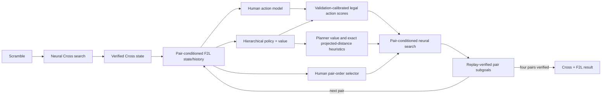

# Experiment report

**Run date:** 2026-11-17  
**Dataset:** synthetic shortest-Cross BFS oracle, seed 17  
**Device:** Apple Silicon MPS, PyTorch 2.8.0  
**Status:** completed prototype experiment; not a human-imitation result

## Data and split

The generator created 1,200 unique scramble/solve groups. Groups were assigned by scramble ID before move samples were expanded, so no scramble or solve crosses a split.

| Split | Solve groups / scrambles | State-action samples |
| --- | ---: | ---: |
| Train | 960 | 5,519 |
| Validation | 120 | 679 |
| Test | 120 | 698 |

All samples have `sample_kind: synthetic`, `cross_face: D`, `cross_color: white`, and `data_source: synthetic:shortest-cross-bfs-v1`. The label is a deterministic shortest white Down Cross action, not a human choice.

## Models and training

All models started with random PyTorch initialization and used cross-entropy, AdamW, gradient clipping, ReduceLROnPlateau, early stopping, and seed 17. The MLP uses hidden sizes 256 and 128. The Transformer uses 2 layers, 4 heads, 64-dimensional embeddings, and history length 8.

| Model | Inputs | Best epoch | Best validation loss | Best validation Top-1 |
| --- | --- | ---: | ---: | ---: |
| MLP state-only | 54 facelets | 6 | 1.4841 | 57.14% |
| MLP state + history | facelets + last 8 moves | 5 | 1.4168 | 58.76% |
| Transformer state + history | facelet and move tokens | 24 | 1.4830 | 57.00% |

Recorded training-loop time was approximately 3.6 s (state-only MLP), 13.1 s (history MLP), and 46.8 s (Transformer) on the MPS device. Epoch metrics are preserved in `artifacts/*.jsonl`; checkpoint metadata includes seed, architecture, best epoch, validation metrics, and dataset hashes.

## Held-out results

Teacher-forced predictions are evaluated on the same 698 samples from 120 unseen scrambles. The frequency baseline uses only training labels and add-one smoothing.

| Policy | Cross-entropy ↓ | Top-1 | Top-3 | Top-5 | Batched forward ms/sample ↓ |
| --- | ---: | ---: | ---: | ---: | ---: |
| Global move frequency | 2.8124 | 10.17% | 24.36% | 40.26% | — |
| MLP state-only | 1.4543 | 59.31% | 78.94% | 86.53% | 0.0016 |
| MLP state + history | 1.3756 | **60.60%** | 79.37% | 86.53% | 0.0020 |
| Transformer state + history | 1.4706 | 56.59% | 76.79% | 84.96% | 0.0250 |

Latency is the mean per-example time for 20 repeated batches (up to 128 examples), after 5 warm-up batches, measured on MPS. It is a rough computational measure, not human recognition or execution time. This was one short benchmark run; small latency differences should not be overinterpreted.

## Autoregressive Cross rollout

Each test solve starts from its initial cube state and the selected policy predicts up to 20 moves. This differs from teacher-forced evaluation because the policy acts on its own previous predictions.

| Policy | Completed Crosses | Completion rate | Successful move count (mean / median) |
| --- | ---: | ---: | ---: |
| MLP state-only | 7 / 120 | 5.83% | 6.71 / 6 |
| MLP state + history | 15 / 120 | 12.50% | 9.27 / 10 |
| Transformer state + history | 18 / 120 | 15.00% | 12.33 / 13 |

For context, the synthetic oracle's shortest Cross paths on these same 120 starts averaged 5.82 moves (median 6, range 4–7). Successful neural rollouts often take longer, and most rollouts fail within the 20-move cap. The Transformer has the highest completion rate in this run at 15%, but it has lower teacher-forced scores than the history MLP and needs more moves on successful rollouts.

## Policy-guided beam search

Because the state-only MLP's greedy rollout failed frequently, I tested a small decoding/search change without retraining the model. At each depth the search expands the current beam using the MLP's action probabilities, accumulates log probability, prunes consecutive turns of the same face, and verifies Cross completion in the simulator. It does not use the exact BFS action or distance to guide search; BFS is used only after a solution is found to measure the shortest-path gap.

Beam width was selected on the 120-scramble validation split, with a 10-move cap:

| Beam width | Validation Crosses | Mean moves when solved | Mean ms/start on MPS |
| ---: | ---: | ---: | ---: |
| 16 | 65 / 120 (54.2%) | 6.08 | 49.9 |
| 32 | 97 / 120 (80.8%) | 6.42 | 57.8 |
| 64 | 107 / 120 (89.2%) | 6.16 | 95.1 |
| 128 | 115 / 120 (95.8%) | 6.07 | 164.0 |
| 256 | 119 / 120 (99.2%) | 5.96 | 309.1 |

Width 256 was selected before evaluating the test split. On the 120 held-out test scrambles it completed 119 (99.2%), compared with 7 (5.8%) for greedy rollout using the same checkpoint. Successful search paths averaged 6.06 moves (median 6); 77.3% matched the exact shortest Cross length, and the mean excess over BFS was 0.25 moves. The one failure did not complete within 10 moves. The run scored 127,976 parent states, took 38.11 seconds total, or about 318 ms per start on MPS.

Exact BFS completed all 120 test Crosses with the shortest path, averaging 5.82 moves (median 6). This remains the deterministic reference; its runtime was not benchmarked in this sweep. Neural beam search is useful here as evidence that search can rescue a weak greedy policy, not as a better solver than the exact oracle. The neural model did not change its 59.31% teacher-forced Top-1 accuracy. Human data, human decision similarity, and human recognition or execution time remain unmeasured.

This hybrid direction is consistent with prior work: [Levin Tree Search](https://deepmind.google/research/publications/21589/) guides search with action-sequence probabilities, while [DeepCubeA](https://www.nature.com/articles/s42256-019-0070-z) combines a learned cost-to-go estimate with search. DeepCubeA's full-cube benchmark is a different task and dataset, so its published solve/optimality rates are not a direct numerical comparison to this Cross-only experiment.

## Interpretation and failure analysis

- All neural policies beat the frequency baseline on this synthetic generator, which confirms that the pipeline can learn state-dependent move labels.
- History slightly improved this one MLP run: Top-1 rose from 59.31% to 60.60%, and rollout completion rose from 5.83% to 12.50%. This is a single seed and one small ablation, not evidence that history generally helps.
- The final randomly initialized Transformer run underperformed the history MLP on cross-entropy and Top-1/3/5. It completed more held-out rollouts (15% vs 12.5%) but used more moves when successful; the architecture comparison provides no evidence that this Transformer is better overall.
- Teacher-forced Top-1 near 60% coexists with rollout success at or below 15%. Errors compound once the policy leaves demonstrated trajectories. This is the clearest failure in the current experiment.
- The teacher itself is an exact shortest-Cross oracle. The experiment cannot show that either architecture learned human-like preferences, CFOP lookahead, ergonomics, or execution speed.

No model-architecture/training hyperparameter sweep, repeated-seed study, held-out-solver evaluation, human comparison, or statistical significance test was run. One small validation-only beam-width sweep selected search width; it does not establish a generally optimal setting. The results are a reproducible engineering baseline and should be extended with permission-cleared human data before making behavioral claims.

## Reproduction

From the repository root:

```bash
python -m cubemind.data.prepare --solves 1200 --seed 17
python -m cubemind.train --config configs/mlp_state_only.yaml
python -m cubemind.train --config configs/mlp.yaml
python -m cubemind.train --config configs/transformer.yaml
python -m cubemind.evaluate --checkpoint artifacts/mlp-state-only.pt --beam-width 256 --beam-max-moves 10 --output artifacts/eval-mlp-state-only.json
python -m cubemind.evaluate --checkpoint artifacts/mlp-state-history.pt --output artifacts/eval-mlp-state-history.json
python -m cubemind.evaluate --checkpoint artifacts/transformer-state-history.pt --output artifacts/eval-transformer-state-history.json
```

Machine-readable test metrics are stored in `artifacts/eval-*.json`; training curves are in the adjacent JSONL logs.

## Initial reco.nz pilot (150-solve cap)

**Data:** the local reco.nz collection contains 149 replay-valid 3×3 CFOP solves by 32 cubers. The raw and processed rows are kept locally and excluded from Git. Splits are grouped by solver: 127 train solves / 25 solvers, 13 validation / 3, and 9 test / 4. There are 3,869 labeled actions in Cross, Cross+1, and F2L; this sample has no explicit ZBLS demonstrations.

The from-scratch context model uses cube state, recent moves, phase, selected Cross color, edge orientation, move count, and pair/cross status. On 200 held-out actions it reached 35.0% Top-1, 63.5% Top-3, and 76.0% Top-5. Ordinary F2L Top-1 was 43.7%; Cross Top-1 was 0/5, too few labels for a useful Cross estimate. The state-only ablation scored 22.5% Top-1, while the training-label frequency baseline scored 15.5%. These scores measure exact next-action agreement with reconstructions, not quality of the resulting solve or inferred inspection intent. Batched model latency was 0.00151 ms/action on MPS.

The corpus reflects the user's notes about Cross+1, pair order, pseudo-slotting, and color choice only where the source reconstruction annotates them. The model does not infer unmarked intent, characterize a solver's full color neutrality from one solve, or plan a full F2L route.

## Expanded reco.nz corpus and retraining

The full current 3×3 CFOP index contained 9,288 unique entries after duplicate solve IDs were removed. OH and non-CFOP methods/events were excluded, consistent with the project’s 3×3 CFOP scope; this is not the entire site-wide archive of roughly 14,000 solves. Of the filtered entries, 9,109 complete reconstructions passed simulator replay. All 179 initially rejected entries were fetched again after adding support for grouped and compact move notation. The remaining exclusions were 13 unsupported notations, 165 full-sequence replay failures, and 1 reconstruction page with no move list. The rejection list is local at `data/raw/reco_nz/cfop_3x3_rejected.jsonl`.

The accepted corpus yielded 324,097 annotated action rows: 39,164 Cross, 30,619 Cross+1, 253,051 F2L, and 1,263 explicitly annotated ZBLS actions. Solver-grouped splits were 6,654 train solves / 308 solvers / 237,766 actions; 1,407 validation solves / 39 solvers / 48,274 actions; and 1,048 test solves / 39 held-out solvers / 38,057 actions. No solver appears in more than one split. Gradient updates used only train rows; validation selected checkpoints.

The policy is a random-initialized PyTorch MLP with 256- and 128-unit hidden layers. Inputs are one-hot facelets, the previous eight moves, phase, available pair-strategy annotations, selected Cross color, edge orientation, Cross status, solved F2L-slot count, and move count. The context and state-only models used AdamW, cross-entropy, gradient clipping, and 20 epochs; the checkpoint with minimum validation loss was retained (epoch 4 for context and epoch 7 for state-only, seed 17, MPS).

| Model/baseline | Top-1 | Top-3 | Top-5 |
| --- | ---: | ---: | ---: |
| Context-aware MLP | 56.75% | 82.15% | 90.60% |
| State-only MLP | 49.76% | 76.46% | 88.16% |
| Training-label frequency | 18.12% | 49.71% | 70.87% |

The context model's phase Top-1 was 37.19% Cross (4,501 actions), 39.05% Cross+1 (3,060), 61.42% ordinary F2L (30,346), and 58.67% ZBLS (150). Batched MPS inference measured 0.00133 ms/action. These are exact demonstrated-next-move agreement scores, not full-solve success, move optimality, or human timing.

The initial 149-solve pilot above and the intermediate 8,652-solve run had different solver-held-out test partitions. Their scores must not be compared as paired results with this final run; the corpus and held-out solver composition changed.

## All-method 3×3 archive

A separate all-method query for the 3×3 event found 10,474 unique index entries. The simulator accepted 10,274 complete reconstructions: 9,129 CFOP, 557 ZB, 515 Roux, 45 ZZ, 26 Petrus, and 2 CF. It rejected 200 entries (183 failed full replay, 15 unsupported notation, 1 page without moves, and 1 page without phase-annotated solution moves). The raw archive and rejection log are local at `data/raw/reco_nz/all_3x3.jsonl` and `data/raw/reco_nz/all_3x3_rejected.jsonl`.

The broad all-method crawl and dedicated CFOP-filtered crawl returned non-identical CFOP IDs: 120 appeared only in the broad scan and 100 only in the focused scan. The source index is paginated and these passes should be treated as separate snapshots. The CFOP model above uses the reproducible dedicated-filtered corpus (9,109 valid solves); the broad archive is not merged into model training. The roughly 14,000 site-wide count includes records outside this project's 3×3 event filter.

## ZBLL classifier and exact recognition

`zbll_cases.json` provides 472 ZBLL plus 21 PLL identities. CubeMind generates AUF/orientation presentations by simulator from each primary algorithm and splits by presentation transform. The test has 4,930 examples; every one of the 493 case labels also occurs in training and validation, while exact facelet states do not cross splits. This tests recognition of known identities under new presentations, not held-out case discovery.

The random-initialized 493-way PyTorch MLP trained for 15 epochs on MPS (seed 17). It reached 99.23% Top-1, 100% Top-3/Top-5, and 0.0345 cross-entropy. The training-label frequency baseline was 0.20%. The exact deterministic AUF/orientation-normalized lookup reached 100% on the same 4,930 examples and remains the reference; this result does not show a neural advantage. CPU neural inference measured 0.00202 ms/sample in batches of 128. Exact recognition measured 0.0913 ms/sample with a sequential CPU loop, so those latency measurements are not directly comparable.

The interactive last-layer view displays the cube state, exact case, neural predicted case and algorithm, and a solution replay-verified by CubeMind's simulator. The algorithm is selected from the fixed database after exact recognition. The neural classifier supplies a case prediction; it does not generate an algorithm.

## Algorithm sources and replay checks

ZBLL/PLL algorithms use the MIT-licensed Alg-Trainer source. ZBLS uses the user-selected CubeRoot public 3×3 API snapshot (`2026-05-04T00:13:11Z`): 305 source entries include three setups with all four F2L slots already complete, leaving 302 three-slot cases. The importer keeps each source case ID and original algorithm notation, selects one primary from the same slot orientation, normalizes the notation, and rejects any case that fails the simulator's Cross/F2L/edge-orientation checks. All 302 imported primary algorithms passed. Rebuild with `python scripts/import_cuberoot_zbls.py`.

## Paired conventional and EO-aware CFOP benchmark

The deterministic [`@moishy/cfop` 0.4.0](https://www.npmjs.com/package/@moishy/cfop) package solved the same 20 seeded 25-turn outer-move scrambles for both policies. Cross was fixed white on Down. Conventional mode uses the package's normal Cross → F2L → OLL → PLL path; EO-aware mode forces its ZBLS → ZBLL path and falls back to conventional F2L if that path fails. This benchmark uses the package's own algorithm tables, not CubeMind's neural models or imported algorithm files.

| Measure | Conventional CFOP | EO-aware CFOP |
| --- | ---: | ---: |
| Solves | 20/20 (100%) | 20/20 (100%) |
| ZBLL eligible at policy transition | 1/20 (5%) | 20/20 (100%) |
| ZBLS / ZBLL used | 0 / 0 | 20 / 20 |
| Mean STM | 51.50 | 47.15 |
| Median STM | 51 | 47 |
| Mean compute time | 1,482.7 ms/solve | 711.4 ms/solve |

These are single-run deterministic package outputs on one machine and only 20 scrambles; they do not establish a general move-count or speed advantage. Human recognition and execution time were not measured. The difference in compute time is an implementation/runtime property, not a human-speed result.

Reproduce the added experiments from the repository root:

```bash
python scripts/import_cuberoot_zbls.py
python -m cubemind.train_f2l --epochs 20
python -m cubemind.train_zbll --epochs 15 --seed 17
npm run benchmark:cfop
pytest
```

## End-to-end neural CFOP policy experiment

This experiment asks whether project-trained policies can generate complete CFOP solutions, beyond next-move imitation. The original human model and its solver-held-out 56.75% Top-1 result remain separate. This full-solver model used **zero reco.nz action rows**: 120 synthetic CFOP training trajectories and 24 validation trajectories from `@moishy/cfop` 0.4.0, plus simulator-replayed MIT Alg-Trainer ZBLL/PLL algorithm paths. New trajectories and algorithm targets are labeled synthetic and replay-checked in CubeMind.

The PyTorch model was initialized randomly. Its 920 inputs encode 54 one-hot facelets, eight recent actions, phase, standard-F2L context, fixed white-Down Cross color, EO/Cross/slot progress, and move count. A shared 256/128 GELU encoder feeds a 72-action policy head and a scalar remaining-moves value head. It trains with cross-entropy plus 0.1-weighted smooth-L1 value loss, AdamW, phase-balanced sampling, and best macro-validation loss. Four AUF presentations are generated for each known ZBLL case; this split tests new presentations of known cases, not unseen case identities.

### Recovery data and model

The first policy's rollout failed after Cross. The recovery pass collected DAgger-style synthetic labels by running the project's Cross MLP search on only base train/validation scrambles, then asking the reference package for verified F2L/OLL/PLL paths from the resulting states. Of 48 selected train and 8 selected validation scrambles, Cross search succeeded on 38 and 7 respectively; the other 11 were recorded as failures and excluded. The Cross beam was width 32, depth 10, and capped at 5,000 nodes. The successful 45 paths inherit the source split and include the Cross prefix in action history. No benchmark scramble or human solve entered aggregation.

The final model was trained from scratch with seed 79 on MPS; it selected epoch 6. There were 23,263 training action rows, 9,512 validation action rows, and 7,949 held-out ZBLL AUF-presentation action rows. Validation Top-1/Top-3 were Cross 20.45%/38.64%, F2L 50.58%/76.13%, OLL 64.82%/85.77%, PLL 70.47%/88.34%, and ZBLL 58.45%/87.24%. Held-out ZBLL-presentation Top-1/Top-3 were 58.27%/86.44%. The F2L validation Top-1 is effectively unchanged from the pre-DAgger model's 50.66%; these separately initialized runs do not establish a DAgger improvement. The earlier checkpoint and run remain at `artifacts/neural-cfop-policy-pre-dagger.pt` and `artifacts/neural-cfop-benchmark-pre-dagger.json`.

### Held-out end-to-end benchmark

The latest evaluation used 100 distinct 25-turn outer-move scrambles, seed 20261124, separate from training and validation scrambles. Search used a width-256, depth-10, 10,000-node Cross beam followed by a phase beam of width 4, branching 3, and at most 500 nodes per phase; total move budget was 120. The human-F2L hybrid uses the reco.nz F2L checkpoint for F2L action probabilities and the synthetic-trained value head; its Cross and last-layer models are the same as the synthetic-only route. No mode uses deterministic rescue. All reported successes require full simulator verification.

| Mode | Full solves | Cross | F2L | ZBLL eligible | Mean / P95 runtime (ms) | Mean nodes |
| --- | ---: | ---: | ---: | ---: | ---: | ---: |
| Original Cross MLP greedy | 0/100 | 11% | 0% | 0% | 11.3 / 17.0 ms | 9 |
| Phase policy greedy | 0/100 | 0% | 0% | 0% | 29.9 / 39.1 ms | 16 |
| Synthetic neural greedy | 0/100 | 11% | 0% | 0% | 16.7 / 67.7 ms | 12 |
| reco.nz F2L hybrid greedy | 0/100 | 11% | 0% | 0% | 17.4 / 75.7 ms | 12 |
| Synthetic neural-guided search | 0/100 | 99% | 0% | 0% | 3,552.7 / 4,909.4 ms | 1,201 |
| reco.nz F2L hybrid search | 0/100 | 99% | 0% | 0% | 3,569.6 / 4,981.6 ms | 1,201 |
| Deterministic CFOP reference | 100/100 | 100% | 100% | 17% | 1,497.2 / 2,639.1 ms | 0 |

For 0/100 neural full solves, the Wilson 95% interval is 0–3.70%; successful neural move counts are therefore not available. Search reached F2L on 99/100 cases but neither the synthetic nor the reco.nz-guided F2L model completed a pair set on any case. The existing human policy was trained on 237,766 reco.nz action labels; adding it left the stage-completion rates unchanged. This does not show that human data are unhelpful generally; this particular interface and policy failed on these states. The deterministic reference averaged 50.91 STM (median 51). Its compute time is a software measurement, not a human speed estimate. Recognition and execution times were not measured.

Teacher-forced accuracy on reference trajectories generated for this test set was Cross 21.68%, F2L 48.20%, OLL 61.97%, and PLL 67.42% Top-1. These synthetic action scores do not predict complete-solve success. The separate ZBLL case classifier and deterministic exact recognizer remain case-recognition results, not evidence that the policy can execute ZBLL.

The result shows the current gap between imitation, valid solution generation, solution efficiency, and human-practical solving. Neural-guided search recovered Cross on 99/100 cases but not F2L; neither the DAgger data nor the reco.nz F2L hybrid closed that gap. The deterministic reference is a comparison and synthetic target source only. It is never called by either neural inference mode. Earlier seed-20261121 through seed-20261123 runs are preserved in separate artifacts; the latest result is `artifacts/neural-cfop-benchmark-hybrid-search.json`.

Reproduce from the repository root (the first command creates the seed-73 base data; the second trains the seed-79 model on the cached synthetic and DAgger data):

```bash
python -m cubemind.train_solver --dataset data/processed/neural_solver/cfop_teacher.jsonl --train-solves 120 --validation-solves 24 --epochs 20 --seed 73 --device auto --regenerate
python -m cubemind.train_solver --dataset data/processed/neural_solver/cfop_teacher.jsonl --train-solves 120 --validation-solves 24 --epochs 20 --seed 79 --device auto
python -m cubemind.benchmark_solver --output artifacts/neural-cfop-benchmark-hybrid-search.json --count 100 --seed 20261124 --device auto --beam-width 4 --branching 3 --max-nodes 500 --max-moves 120
streamlit run demo/app.py
```

## Milestone B — hierarchical neural-guided four-pair F2L

This experiment extends the existing neural Cross stage through all four CFOP F2L pairs. It stops before OLL, PLL, or ZBLL. A solve counts only when the Cross and all four corner-edge pairs are independently replay-verified in CubeMind's simulator. Neither the teacher package nor deterministic F2L solver is called during inference.

### Diagnosis

The old 100-scramble flat search baseline started from a completed Cross in 100/100 cases but solved all four F2L pairs in 0/100 with either the synthetic policy or the reco.nz policy. On the new final set, independently replaying their partial paths showed that neither flat solver preserved the Cross at its final state in any case. The flat search targeted the entire F2L phase at once with width 4, branching 3, and a 500-node cap; it had no committed pair subgoal to give useful partial progress.

The previous human model was not simply an inaccurate move predictor: on the same 18,385 held-out F2L actions its Top-1 was 64.92%, compared with 58.30% for the new model. Yet the flat human-policy search completed F2L on 0/100. The clearest bottleneck was long-horizon goal-conditioned search and its phase/subgoal handling, rather than exact next-action accuracy alone. Training and inference now use the same 916-element encoding and simulator-derived pair identities. A small source-shift check solved 10/10 held-out human F2L states, 9/10 deterministic-reference Cross states, and 9/9 neural-Cross development states. Those ten-case diagnostics do not rule out distribution shift generally, but they do not support it as the dominant failure in this run.

The pair detector checks the correct corner and edge, their orientations, and their named slot relative to current center colors. Tests cover all 16 solved-pair masks and rotated Cross frames. The search may temporarily disrupt Cross or an already solved pair, but it commits a subgoal only when Cross, the selected pair, and every protected pair are restored. The held-out neural search logged 420 temporary pair-destruction events across 100 cases, while preserving the Cross at the end in 100/100.

### Model, search, and training data

The randomly initialized PyTorch MLP has a shared 256/128 GELU encoder and three heads: 72 move scores, remaining-move value, and four-way pair selection. Inputs contain the 54 facelets, eight recent moves, current/protected pair masks, target pair, Cross status, edge orientation, solved-slot count, and move count. Pair-order labels are reconstructed only when replay shows a new slot transition; the model does not infer unannotated inspection intent or explicit pseudo-slot intent.

Search selects a pair with the learned selector, expands the policy's top six legal outer turns, and ranks candidates with the learned value, action score, exact single-pair projected distance, exact Cross distance, and distances for protected pairs. The pattern distances are scalar search heuristics; they return no F2L move sequence and are not algorithm lookups. The final settings were beam width 128, max depth 22, 6,000 expanded parent states per solve, and up to 24 pair-order attempts. Pair order can backtrack after a failed insertion attempt. A matched uniform-action ablation randomizes the six action branches while retaining the same value head, pair selector, projected distances, and budgets.

Training kept the raw human corpus and simulator demonstrations as separate inputs with explicit per-row source labels. Human splits remain grouped by solver, and held-out test rows were not used for updates. The final training file contains 102,534 human action labels, 3,043 CFOP-teacher actions, 940 existing DAgger actions, and 625 on-policy recovery actions (107,142 total). Pair-order labels total 15,327: 14,606 human, 473 CFOP-teacher, 152 DAgger, and 96 recovery labels. Recovery generated 24 candidate trajectories from training-only states; all 24 teacher corrections passed Cross/F2L simulator checks, with no rejected cases. The final file preserves the `data_source` and `sample_kind` for every row.

The model was trained on MPS from random initialization with seeds 79 and 80; seed 80, epoch 8, had the better validation loss. On 21,032 validation action rows, Top-1/Top-3 were 59.83%/86.92%, pair-selector accuracy was 60.66%, and remaining-move MAE was 1.96. On the solver-held-out test set (18,385 actions and 2,589 pair-order decisions), action Top-1/Top-3 were 58.30%/86.34%, selector Top-1 was 56.89%, and value MAE was 2.11. On the exact same action rows, the previous reco.nz model scored 64.92%/90.21%. The new model therefore improves complete solving without improving exact human next-move imitation.

### Curriculum and value checks

The training sampler covers all four subgoal stages, from four unsolved pairs (zero protected pairs) to one remaining pair (three protected pairs). Held-out training-source pair-start states were evaluated separately, five per stage: one remaining pair 5/5, two remaining 5/5, three remaining 5/5, and four remaining 5/5. This is a small stage diagnostic, not a separate 100-case curriculum benchmark. The model was trained jointly across stages rather than through sequential stage-by-stage fine-tuning.

With the 9 crossed states in the 10-case development run, the value weight at 0.5 completed F2L in 9/9 (3,206 mean expanded nodes); setting the value contribution to zero completed 8/9 (3,484 mean nodes). Mean runtime was about 10.1 s versus 7.6 s, respectively, because the value-scored run did more model inference. This small development ablation suggests a completion benefit but is too small to establish a reliable value-head speedup. The separate action-guidance ablation below provides the stronger policy contribution test.

### Held-out 100-scramble results

The final seed 20261127 contains 100 distinct 25-outer-turn scrambles excluded from known reco.nz and synthetic training scrambles. All 100 neural Cross stages completed. The benchmark JSON includes source/checkpoint hashes, per-case moves and failure causes, pair distributions, search nodes, runtimes, and Wilson 95% intervals. Every reported F2L completion in the table was independently replayed from its original scramble after the benchmark completed.

| Mode | Cross at F2L start | Cross preserved | Final pair distribution (0/1/2/3/4) | Complete F2L | Mean nodes | Mean runtime | STM on successful cases |
| --- | ---: | ---: | --- | ---: | ---: | ---: | ---: |
| Existing synthetic flat | 100/100 | 0/100 | 96/3/1/0/0 | 0/100 | 1,245 | 3.92 s | — |
| Existing reco.nz flat hybrid | 100/100 | 0/100 | 95/5/0/0/0 | 0/100 | 1,246 | 3.97 s | — |
| Hierarchical greedy | 100/100 | 100/100 | 91/5/4/0/0 | 0/100 | 1,102 | 2.80 s | — |
| Hierarchical neural-guided search | 100/100 | 100/100 | 0/0/0/1/98 | **98/100** | 3,925 | 8.83 s | 34.72 mean / 34 median |
| Uniform-action search ablation | 100/100 | 100/100 | 2/7/23/46/22 | 22/100 | 6,765 | 8.04 s | 52.73 mean / 53 median |
| Deterministic CFOP reference | 100/100 | 100/100 | 0/0/0/0/100 | 100/100 | 0 | 1.56 s | 29.92 mean / 30 median |

Hierarchical neural search reached at least one pair in 100/100, at least two in 100/100, at least three in 99/100, and all four in 98/100. Its full-F2L 95% Wilson interval is 93.00%–99.45%. The uniform-action rate was 22/100 (15.00%–31.07% Wilson interval), so policy-guided branches improved completion by 76 percentage points and used 42% fewer mean nodes. Because the ablation retains the learned value and pair selector, it isolates action-branch guidance, not the standalone effect of all neural components.

Ninety-eight cases began with four unsolved pairs and two with one pair already solved. Neural search completed 96/98 and 2/2, respectively. It recorded 3 cases requiring extra pair-target attempts beyond the number of remaining pairs; 2 of those 3 completed F2L. Across 381 replay-detected single-pair insertion segments, the median segment length was 7 turns. The segment count omits paths where multiple slots become solved together, so it is not presented as four independent insertions per solve.

On the 98 scrambles solved by both the neural policy and reference, neural Cross+F2L averaged 34.72 STM (median 34), versus 29.93 STM (median 30) for the reference: 4.80 additional turns on average. Neural-search runtime includes Cross plus F2L search and averaged 8.83 s; the deterministic package averaged 1.56 s. These are machine timings, not human execution or recognition times.

An independently verified example from the held-out set:

```text
Scramble: U2 F' L R' D F R' U B U2 B2 D B2 U D2 L2 B2 L2 F' B L D L D' R'
Cross:    F' D' R' D' R2
F2L order: FL → BR → BL → FR
FL: F U2 F' U2 F2 L F2 L'
BR: U2 B' R B R'
BL: F' L U' L' U2 F L U' L'
FR: R U2 R' U2 F' U' F
Total:    34 STM; Cross and all four F2L pairs verified
```

### Interpretation and remaining work

Milestone B met the specified threshold: 98/100 verified Cross+F2L cases, with no inference-time reference fallback. The old model's greater teacher-forced accuracy did not solve the long-horizon phase objective; explicit pair selection, protected subgoals, stronger search, and neural action guidance did. Flat search also frequently returned states that had broken the Cross, while the hierarchical solver required Cross restoration at each committed pair.

The result is not a full CFOP solver. Two searches exhausted their pair budgets, finishing with two and three pairs. The new policy's next-move accuracy is lower than the old human model, and its successful solves use about five more STM than the deterministic package. The source, value, and per-stage diagnostics use small development samples. The old human model was kept unchanged and measured as a flat baseline; it was not fine-tuned into the new hierarchical architecture. The new training pipeline also infers a single newly completed pair at a time, so simultaneous pair completions and explicit human pseudo-slot/inspection intent are not modeled as separate labels. No last-layer, recognition-time, or human-execution-speed result is claimed.

Reproduce the training and held-out benchmark from the repository root:

```bash
python -m cubemind.train_hierarchical_f2l --epochs 8 --recovery-count 24 --device auto
python -m cubemind.benchmark_hierarchical_f2l --count 100 --seed 20261127 --device auto --width 128 --branching 6 --max-nodes 6000 --max-depth 22 --output artifacts/hierarchical-f2l-benchmark.json
```

Machine-readable training metrics, complete case rows, and smaller development diagnostics are in `artifacts/hierarchical-f2l-training.json`, `artifacts/hierarchical-f2l-benchmark.json`, and `artifacts/hierarchical-f2l-development-diagnostics.json`.

## Expert-aware F2L extension

This extension tests whether solver-held-out human action and pair-order predictions help the existing pair-conditioned search. The historical planner checkpoint and its 98/100 benchmark were not overwritten. The legacy reco.nz model uses a different feature coordinate system, so it was retained as a compatibility diagnostic and a new canonical-frame action model was trained from random initialization on human reco.nz rows only. A separate from-scratch pair selector used replay-verified human pair-order labels. No synthetic teacher actions entered these two models.

Compatibility audit: both policy heads use the simulator's same 72 action IDs, but the planner searches legal outer turns only. The legacy human model expects 919 features while the hierarchical model supplies 916; the state/history fields align only after mapping and setting the observed white-Down, standard-F2L context. Its adapted Top-1 was 45.90%, so the final policy was trained directly in the planner's canonical 916-feature frame. Unsupported human actions were filtered only for the held-out action-scoring comparison (96.57% coverage); they were not silently remapped. Inference fixes white on Down and does not model rotations, wide turns, color-neutral inspection, or unannotated pair intent.



The canonical action model trained on 102,534 rows (seed 1701, best epoch 12); the pair selector trained on 14,606 human pair-order examples (seed 1702, best epoch 9). Solver-held-out calibration selected expert temperature 1.0, planner temperature 1.0, and expert weight 1.0. Thus the selected action distribution is the expert model alone; validation did not support an interpolated planner/expert blend. Evaluation filters to human next actions representable by the planner's legal outer-turn vocabulary (17,754 of 18,385 test actions, 96.57%).

| Solver-held-out task | Model | Cross-entropy ↓ | Top-1 | Top-3 |
| --- | --- | ---: | ---: | ---: |
| Human next action (17,754 legal test rows) | Canonical expert action model | 0.8721 | 69.13% | 92.60% |
| Same rows | Mixed hierarchical planner | 1.0825 | 60.57% | 89.63% |
| Same rows | Legacy reco model through feature adapter | 1.8932 | 45.90% | 71.47% |

The canonical expert model's top action matched the planner on 71.38% of test rows. For 2,589 held-out human pair-order decisions, the expert-only selector reached 62.34% Top-1 and 87.49% Top-2; the mixed planner selector reached 56.89% and 84.36%. These are teacher-forced agreement scores on reconstructions, not evidence that the selected action is optimal or that the policy captures unannotated inspection intent.

The final fresh evaluation contains 100 unique 25-turn scrambles (seed 20261130), regenerated exactly from the recorded seed and excluded from the training/reconstruction and prior benchmark scramble sets. All modes used the same Cross model, width 128, branching 6, 6,000-node cap, depth 22, and 24 pair-order attempts. The original planner and legal-normalized planner use the unchanged hierarchical checkpoint. All completions were replay-verified, and neural modes had no deterministic fallback.

| Mode | Cross preserved | Complete F2L (Wilson 95%) | Mean / median STM = HTM | Mean nodes | Mean mode time |
| --- | ---: | ---: | ---: | ---: | ---: |
| Original hierarchical planner | 100/100 | 90/100 (82.56–94.48%) | 34.07 / 34 | 4,207 | 13.76 s |
| Same planner, legal-action normalized | 100/100 | 90/100 (82.56–94.48%) | 34.17 / 34 | 4,191 | 14.37 s |
| Expert action + expert pair selector | 100/100 | **95/100 (88.82–97.85%)** | 34.40 / 33 | 4,037 | 13.89 s |
| Deterministic CFOP reference | 100/100 | 100/100 | 30.69 / 30 | — | 1.48 s |

The expert-aware policy reached the 95% point target on this fresh set. Against either planner mode, 87 cases were solved by both, 8 only by the expert-aware mode, 3 only by the planner, and 2 by neither. The paired exact McNemar test gives p=0.227, so the five-point difference is not statistically significant at the 5% level. The historical 98/100 result remains unchanged on its own seed; on this new seed the exact original mode reached 90/100.

Move efficiency did not improve. On all successful cases the expert-aware mean was 34.40 STM, versus 34.07 for the exact original planner and 34.17 for legal normalization. Among the 87 cases both policies solved, the expert-aware route used 0.49 more STM on average than the original planner (median difference 0); it was shorter on 36 cases, tied on 8, and longer on 43. The reference's mean 30.69 STM measures its Cross+F2L path. Neural mode time includes Cross and F2L search, while the reference's 1.48 s is the package's full-solve query, so these are descriptive compute timings rather than a matched speed comparison. Rotations and adjacent same-face turns were zero because the search vocabulary/pruning uses outer turns; this does not establish human ergonomics. Human ratings, recognition time, fingertricks, TPS, pauses, and execution time were not measured.

The policy's five failures were pair-search-budget exhaustion (two BL, one FL, two FR). The original planner's ten failures were pair-search-budget exhaustion (one BL, two BR, one FL, six FR). Cross succeeded and remained solved in all 100 cases. The previous 20-case pilot is retained as `artifacts/expert-aware-f2l-benchmark-20-case-pilot.json` and is not used as the final estimate.

### Component ablations on the 20-case pilot

The following modes share the pilot's exact 20 scrambles (seed 20261129) and matched search limits. They are diagnostic only; their confidence intervals are wide. "Expert action only" retains the planner's value and pair-selection heads. "Expert pair order" retains planner move scores. Execution-cost mode chooses among pair orders by STM only; it is a move-count proxy, not a model of ergonomics or execution speed.

| Mode | Complete F2L (Wilson 95%) | Mean / median STM | Mean nodes | Mean runtime |
| --- | ---: | ---: | ---: | ---: |
| Legal-normalized planner | 20/20 (83.9–100%) | 33.45 / 33.0 | 3,854 | 13.16 s |
| Expert action only | 19/20 (76.4–99.1%) | 33.79 / 34.0 | 4,188 | 14.46 s |
| Expert pair order only | 18/20 (69.9–97.2%) | 32.89 / 33.5 | 3,937 | 13.43 s |
| Expert action + pair order | 20/20 (83.9–100%) | 34.80 / 34.5 | 3,817 | 12.99 s |
| Uniform legal action order | 9/20 (25.8–65.8%) | 54.00 / 56.0 | 6,590 | 21.95 s |
| STM execution-cost search | 20/20 (83.9–100%) | 32.25 / 32.0 | 7,056 | 24.72 s |
| Deterministic reference | 20/20 | 31.10 / 31.5 | — | 1.40 s |

The combined route completed one more case than action-only and two more than pair-order-only in this small set, but its move count was higher. Uniform action ordering completed 9/20. STM-based order search returned fewer moves than the combined route, at higher node count and runtime. The neural rows' times cover Cross+F2L search; reference time is the package's full-solve query and is not a matched compute comparison. The original hierarchical benchmark's separate 100-case uniform ablation was 22/100 versus 98/100 hierarchical search; neither small result should be interpreted as a human execution-speed comparison. The complete per-case pilot and ablation rows are in `artifacts/expert-aware-f2l-benchmark-20-case-pilot.json` and `artifacts/expert-aware-f2l-ablation-20-case.json`.

Representative verified median-length route from the held-out set:

```text
Scramble: F U B2 D2 B' F' U F' U' B2 D2 F2 R' F R' B' F R' L D B2 R2 D' F' D'
Cross:    D2 F' U' L R F'
F2L order: BL → FL → FR → BR
BL: R' U' L U' R L'
FL: B U B' U F U F'
FR: B U' B' F' U' F
BR: U' B U' B' U B U B'
Total:    33 STM; Cross and all four pairs verified
```

Reproduce training and the paired 100-scramble comparison from the repository root:

```bash
python -m cubemind.train_expert_aware_f2l --epochs 12 --seed 1701 --device auto
python -m cubemind.benchmark_expert_aware_f2l --count 100 --seed 20261130 --device auto --modes planner_original,planner_legal,combined --width 128 --branching 6 --max-nodes 6000 --max-depth 22 --output artifacts/expert-aware-f2l-benchmark.json
python -m cubemind.benchmark_expert_aware_f2l --count 20 --seed 20261129 --device auto --modes expert_action_only,expert_pair_order,uniform_action,execution_cost --width 128 --branching 6 --max-nodes 6000 --max-depth 22 --output artifacts/expert-aware-f2l-ablation-20-case.json
```

Training and held-out predictions are in `artifacts/expert-aware-f2l-evaluation.json`; final case-level results are in `artifacts/expert-aware-f2l-benchmark.json`, with the standalone exact-original-mode raw run in `artifacts/expert-aware-original-planner-100.json`. The pilot ablation table combines `artifacts/expert-aware-f2l-benchmark-20-case-pilot.json` and `artifacts/expert-aware-f2l-ablation-20-case.json`. Checkpoints are `artifacts/canonical-expert-f2l.pt` and `artifacts/expert-aware-pair-selector.pt`. That standalone comparison isolates Cross+F2L; the later Last-Layer integration is reported below.

## Milestones C and D: neural Last Layer and full cube

This extension reuses the existing expert-aware neural Cross/F2L checkpoints and adds a Last-Layer policy/value network. Neural inference never calls the OLL/PLL/ZBLL algorithm table or the deterministic full-cube solver. Every reported full solve was replayed from its scramble in the CubeMind simulator; the deterministic CFOP package appears only as a labeled reference. The earlier Cross experiments and Cross+F2L benchmarks remain unchanged.

### Training and held-out human agreement

The randomly initialized PyTorch MLP encodes 920 state/history features, uses 256/128 hidden units, and predicts 72 simulator actions plus a remaining-cost value. It was trained for up to 24 epochs with seeds 73/74/75; seed 73 at epoch 11 was selected by validation. Training combines separate local JSONL sources: replay-confirmed human reconstruction actions and simulator-generated CFOP/ZBLL paths. The training report records 43,227 human OLL, 69,613 human PLL, and 375 human ZBLL actions, with 9,364 synthetic OLL, 14,750 synthetic PLL, and 25,050 synthetic ZBLL actions. Human splits hold out solver identities (277 train solvers; 35 test solvers); synthetic ZBLL splits hold out case identities. Raw reco.nz data remain local-only.

On the held-out human solvers, next-action agreement was OLL 70.61% Top-1 / 88.69% Top-3 (5,702 actions), PLL 73.84% / 89.70% (10,343), and ZBLL 69.57% / 91.30% (69). These are reconstruction-action agreement scores, not evidence of human intent, algorithm quality, or execution speed.

### Controlled Last-Layer test

The final search configuration was selected on validation (beam 128, branching 8, 20,000 maximum search nodes, action score weight 1.0, phase move budgets 40/40/100) and then fixed for the held-out test.

| Controlled state set | Completion | Wilson 95% interval | Mean STM | Mean nodes | Mean compute time |
| --- | ---: | ---: | ---: | ---: | ---: |
| PLL | 158/158 (100%) | 97.63–100% | 13.06 | 1,248 | 697 ms |
| OLL → PLL | 158/158 (100%) | 97.63–100% | 22.98 | 2,053 | 1,121 ms |
| Eligible ZBLL | 194/200 (97%) | 93.61–98.62% | 23.72 | 2,954 | 1,724 ms |

The measured point rates meet the three Milestone C targets. The ZBLL confidence interval still extends below 95%, so the result does not establish 95% population reliability. Exact recognition and the learned case classifier both labeled all 200 test presentations correctly. Case identities were known across pose splits; this is AUF/orientation generalization, not unseen-case discovery, and the classifier does not select solving moves.

### Fresh 100-scramble full-cube test

The held-out set contains 100 distinct 25-turn outer-move scrambles (seed 20261123), filtered against reco.nz, prior evaluation, and generated training hashes. The neural comparison shares the expert-aware Cross/F2L stack. The hybrid baseline uses the historical hierarchical Cross/F2L controller followed by a deterministic CFOP suffix; the deterministic full reference is a separate package solve.

| Mode | Verified solves (Wilson 95%) | Mean successful STM / HTM | Mean nodes | Mean runtime |
| --- | ---: | ---: | ---: | ---: |
| Hierarchical neural Cross/F2L + deterministic Last Layer | 96/100 (90.16–98.43%) | 66.74 / 58.68 | 4,329 | 17.48 s |
| Expert-aware Cross/F2L + neural OLL → PLL search | 93/100 (86.25–96.57%) | 60.87 / 55.81 | 6,348 | 4.15 s |
| Expert-aware Cross/F2L + EO-aware neural search | 90/100 (82.56–94.48%) | 60.90 / 55.89 | 6,670 | 4.37 s |
| Same neural model, greedy Last Layer | 10/100 (5.52–17.44%) | 69.00 / 64.20 | 3,952 | 2.77 s |
| Matched value-only search, no neural action guidance | 0/100 (0–3.70%) | — | 9,238 | 6.25 s |
| Deterministic full CFOP reference | 100/100 (96.30–100%) | 54.18 / 42.47 | 0 | 1.58 s |

Milestone D meets its 90/100 point target: 90 EO-aware full solutions were simulator-verified. Its 95% Wilson interval is 82.56–94.48%, so this 100-scramble result is not a high-confidence guarantee of at least 90% future reliability. The conventional neural OLL→PLL policy solved 93/100. In the paired comparison, both solved 90 cases, conventional solved 3 additional cases, EO-aware solved none additional, and both failed 7 (exact McNemar p=0.25). The data therefore do not show a completion-rate gain from EO-aware routing.

EO eligibility after the actual expert-aware F2L prefix was 10/100; direct neural ZBLL solved 7 of those 10, with no recovery solves recorded. This contrasts with 194/200 on independently generated eligible stage states and shows a material distribution shift on the small set of real pipeline states. The principal full-solve bottlenecks were Cross search (2 failures), F2L pair-search budget (3), OLL search (2), and direct ZBLL search (3) in the EO-aware route. The conventional neural route had the same Cross/F2L/OLL failures and solved those three eligible cases through OLL→PLL. This is a reason to continue F2L-to-ZBLL planning, not a claim that the current F2L policy steers toward ZBLL.

Neural-guided search solved 90/100 versus 10/100 for greedy inference; value-only search solved 0/100 despite exploring more nodes on average. Learned action guidance materially affects solving reliability. The deterministic full reference solved all 100 in fewer moves and lower software runtime. The expert-aware neural route's mean 60.90 STM and 4.37 s are computational measures, not evidence of human speed or better execution. Its average rotation count was 0.07; no human timing, recognition time, fingertrick, or ergonomics labels were collected.

One independently replayed direct-ZBLL example from the final set:

```text
Scramble: L2 F' R F2 D' B2 R' U' D2 L2 B' R B2 D' L2 B2 R' B R' B D2 R' B2 F' L'
Cross:    F' L B' F' D' F
F2L:      B U' B' L U2 F' L2 U2 L2 U' L' F U F' U F R U R' F U F' U' L' U L
ZBLL:     U2 R' U' R U' R' U R F U' R' U2 R U F'
Full:     F' L B' F' D' F B U' B' L U2 F' L2 U2 L2 U' L' F U F' U F R U R' F U F' U' L' U L U2 R' U' R U' R' U R F U' R' U2 R U F'
Result:   solved; 47 STM/HTM, 4,591 search nodes, 2.87 s compute, 0 rotations
```

Reproduce with the training command in `README.md`, followed by the validation and 100-scramble commands there. The final benchmark used CPU on macOS 26.6.2 arm64, Python 3.9.6, and PyTorch 2.8.0. The full test suite passed (74 tests); `artifacts/last-layer-benchmark.json` contains per-scramble moves, phase traces, intermediate states, confidence intervals, and failure reasons. `artifacts/demo-full-solve.jpg` is a Streamlit screenshot of the verified direct-ZBLL example.

## V2: neural ZBLS and bounded global route selection

V2 preserves the Cross/F2L and Last-Layer checkpoints and their benchmark artifacts. It adds a random-initialized PyTorch policy/value/EO model for the last F2L slot and a bounded route comparison across conventional neural OLL→PLL, EO-aware neural last layer, and a three-pair-prefix → neural ZBLS → neural ZBLL route. Only candidates that replay to a solved cube can be selected; among them the selector minimizes STM, then rotations, then expanded search nodes. This is a small candidate comparison, not an exhaustive or globally optimal solver.

### ZBLS training sources and held-out predictions

The synthetic source contains 302 simulator-verified CubeRoot ZBLS case identities and 7,248 simulator-generated presentations. Case-disjoint splits are 211/45/46 identities for train/validation/test. The human source contains only explicitly annotated, replay-verified reco.nz ZBLS segments: 49 train trajectories / 576 actions, 16 validation / 144 actions, and 9 held-out trajectories / 97 actions. Human and synthetic action rows stay separate; the mixed model combines only the training and validation partitions. All three models started from random initialization and selected epoch 6. Raw reconstructions are not copied into the V2 outputs.

| Model | Test source | Action Top-1 / Top-3 | EO accuracy | Value MAE |
| --- | --- | ---: | ---: | ---: |
| Synthetic-only | 10,188 actions from 46 unseen case identities | 51.82% / 82.23% | 99.06% | 0.958 |
| Human-only | 97 actions from 9 held-out trajectories | 21.65% / 41.24% | 95.88% | 3.189 |
| Mixed | synthetic held-out cases | 52.49% / 80.74% | 99.18% | 1.180 |
| Mixed | 97 held-out human actions | 37.11% / 72.16% | 95.88% | 1.989 |

The human test is small and the mixed model's higher agreement is not evidence of more human-like solving. These are teacher-forced next-action metrics. Training source counts, split IDs, epoch histories, and hashes are recorded in `artifacts/v2/zbls-training-evaluation.json` and `artifacts/v2/zbls-manifest.json`.

### Case-disjoint neural ZBLS search

The confirmatory search excludes the 10 case identities used in an earlier exploratory pilot, leaving 36 unseen held-out cases. All neural variants had the same width-32, branching-6, 3,000-node budget; the greedy and uniform controls are labeled separately. The algorithm database is used only for offline training and replay reference, never to choose inference moves.

| Variant | Verified | Wilson 95% interval | Mean STM when solved | Mean nodes | Mean compute time |
| --- | ---: | ---: | ---: | ---: | ---: |
| Synthetic-guided search | 5/36 (13.9%) | 6.1–28.7% | 12.2 | 2,880 | 691 ms |
| Synthetic greedy | 1/36 (2.8%) | 0.5–14.2% | 9.0 | 55 | 13 ms |
| Human-guided search | 2/36 (5.6%) | 1.5–18.1% | 15.0 | 2,980 | 747 ms |
| Mixed-guided search | 2/36 (5.6%) | 1.5–18.1% | 10.0 | 2,925 | 763 ms |
| Matched uniform search | 0/36 | 0–9.6% | — | 3,000 | 728 ms |

Synthetic action guidance beat uniform search on this small case-disjoint sample, but 5/36 is far below a dependable completion rate. Human-only and mixed search did not improve completion. All 36 cases had an offline algorithm replay reference; this is not a deterministic inference fallback. Preserve the negative result when interpreting the model.

### Planner, color handling, and demo

The V2 planner compares routes from one learned Cross result and one expert-aware F2L search, then evaluates a completed-F2L branch and a three-pair prefix branch. It accounts for failed route work in total node/runtime measurements and independently replays selected moves from the original cube. When choosing yellow Cross, it rotates the cube and relabels colors into the checkpoints' canonical white-down input scheme; the emitted moves are still replayed against the original color state. A one-scramble integration smoke solved under both white and yellow Cross, but both selected conventional OLL→PLL, found zero Cross+1 pairs, and exhausted the ZBLS attempt budget. This verifies wiring only, not comparative reliability.

The Streamlit full-solver view now includes `V2 Neural ZBLS Global Planner`, a white/yellow Cross selector, candidate route scores, the ZBLS attempt, exact ZBLL case recognition as a diagnostic, phase move sequences, and full replay verification. Exact case recognition and the offline table do not select V2 moves. Cross+1 pair count is measured by the simulator at the Cross boundary; there is no learned expert Cross/X-Cross planner in this milestone.

### Paired 100-scramble full-solve comparison

The fixed V2 configuration was evaluated on 100 fresh, distinct 25-turn outer-face scrambles (seed 20261128). Every method received the same starts. The deterministic package was run afterward as a labeled reference, not a neural fallback. The V2 selector chooses minimum STM only among complete simulator-verified candidates.

| Route | Verified solves (Wilson 95%) | Mean successful STM | Mean nodes | Mean compute time |
| --- | ---: | ---: | ---: | ---: |
| Conventional neural Cross/F2L → OLL→PLL | 94/100 (87.52–97.22%) | 60.72 | 6,397 | 4.35 s |
| EO-aware neural Cross/F2L → ZBLL when eligible, otherwise OLL→PLL | 94/100 (87.52–97.22%) | 61.73 | 6,620 | 4.48 s |
| Neural three-pair prefix → ZBLS → ZBLL route | 8/100 (4.11–15.00%) | 65.63 | 9,924 | 5.30 s |
| V2 minimum-STM selector across verified candidates | 95/100 (88.82–97.85%) | 60.16 | 16,515 total | 9.55 s total |
| Deterministic CFOP reference | 100/100 (96.30–100%) | 55.03 | 0 | 1.82 s |

Conventional and EO-aware neural routes solved the exact same 94 cases (paired McNemar p=1.0); the EO-aware route averaged 1.01 more STM on those shared successes. ZBLL was eligible after 16/95 completed conventional F2L endpoints (16.8%). The ZBLS search was attempted 98 times and completed the last slot with EO on 8 attempts (8.2%). Only one scramble had a simulator-detected F2L pair already solved at the Cross boundary; this is an outcome count, not evidence of an expert X-Cross decision.

The route selector chose conventional OLL→PLL on 85 scrambles, EO-aware on 5, and the ZBLS route on 5; 5 had no verified route. Against fixed conventional neural CFOP, the selector added one solved case (95 vs 94; exact McNemar p=1.0). On their 94 common successes, selected solutions averaged 60.02 STM versus 60.72 (paired sign test p=0.0039); this reflects the explicit minimum-STM selection rule and does not establish expert likeness or faster human execution. Against the deterministic reference, the selector solved 95/100 vs 100/100 (exact McNemar p=0.0625) and averaged 5.00 more STM on the 95 common solves (paired sign test p=0.000045). The comparison does not support a reliability or move-count advantage over the reference. The V2 selector used about 9.55 seconds and 16,515 nodes per scramble because it runs multiple neural candidates; the reference averaged 1.82 seconds. These are software timings only.

Four failures exhausted an F2L pair-search budget; one additional scramble had no verified complete route after Last-Layer search. Cross completed on all 100. This V2 run does not train an expert Cross/X-Cross policy, enumerate multiple Cross or pair-order candidates, use a learned full-solve value model, or prove globally optimal plans. The 100-scramble results and all case-level trajectories are in `artifacts/v2/full-solve-benchmark.json`, including checkpoint hashes, candidate and selected routes, search cost, failure causes, Wilson intervals, and paired tests. The benchmark command in `README.md` reproduces this comparison; CPU software timing was measured, while human execution and recognition time remain unmeasured.

## V2.1 neuro-symbolic Cross and last-layer pilot

V2.1 keeps the neural search baselines and adds a distinct symbolic algorithm-memory path. Replay audits pass for all 57 OLL identities/240 algorithms, all 21 PLL identities/104 imported variants, all 493 ZBLL/PLL primary identities/algorithms, and all 302 CubeRoot ZBLS setup/algorithm pairs. See [the algorithm-memory audit](algorithm_memory.md).

The new 118,418-parameter Cross action policy was randomly initialized and trained only from explicit human `CROSS` segments on solver-disjoint reco.nz splits. Three seeds were trained; seed 37 was selected on validation loss. On 3,996 held-out actions, Top-1 was 47.37%, Top-3 71.67%, and cross-entropy 1.744, versus majority-action 12.09%/27.08%. These are action-agreement results; the model does not predict inspection intent, Cross-color choice, or X-Cross actions. Cross+1/X-Cross annotations are counted separately.

The paired benchmark uses identical fresh scrambles, the same human Cross and hierarchical F2L policies, and white Cross. On seed 20261129, neural Last-Layer/ZBLS generation solved 93/100; verified algorithm-memory retrieval with the bounded symbolic ZBLS prefix solved 97/100. Conventional neural OLL→PLL solved 93/100 versus 94/100 through symbolic OLL/PLL; both neural and symbolic EO-aware CFOP routes solved 93/100 versus 94/100. The deterministic full-solver reference solved 100/100. The completed-F2L endpoints were ZBLL-eligible in 14/100 cases. In the selected full-solve comparison, symbolic had four successes where neural failed and neural had none where symbolic failed (exact McNemar p=0.125). On common full-solve successes, the symbolic selector used 3.77 fewer STM on average than neural generation (93 shared successes). This is one paired scramble seed; symbolic retrieval uses a finite database and simulator replay, not a learned solver. Human execution and recognition times remain unmeasured. Full results, Wilson intervals, compute cost, route eligibility, and paired rows are in [`artifacts/v2/neurosymbolic-100-benchmark.json`](../artifacts/v2/neurosymbolic-100-benchmark.json).

### Human OLL/PLL algorithm preference

An 8,033-parameter ranker was trained from random initialization on explicit human OLL/PLL segments, after matching a unique normalized table sequence and independently replaying that specific candidate algorithm on the segment's input state. The resulting solver-disjoint set contains 2,169 choices: 1,515 train, 485 validation, and 169 test. The excluded remainder of the 5,738 OLL and 6,033 PLL segments was ambiguous, unmatched, or failed candidate replay.

| Test policy | Top-1 | Top-3 | Paired comparison |
| --- | ---: | ---: | --- |
| Shortest variant | 36.69% | — | Preference-only correct 70; shortest-only 10; exact p=3.16×10⁻¹² |
| Most frequent training choice per case | 75.15% | — | Preference-only correct 3; frequency-only 8; exact p=0.227 |
| Learned preference ranker | 72.19% | 94.67% | Cross-entropy 0.778 |

The ranker improves substantially over choosing the shortest variant, but the sample does not show a gain over the most-frequent-choice baseline. It ranks only OLL/PLL candidates for cases represented during training; it does not select ZBLL/ZBLS algorithms or predict execution/recognition time.

On the same 100 scrambles, shortest and preference ranking both solved 97/100 (Wilson 95% interval 91.55–98.97%; paired exact McNemar p=1.0), with the same three failures. On all 97 common successes, preference ranking averaged 57.18 STM versus 56.31 for shortest selection, an increase of 0.87 STM. Average software time was 6.98 s versus 6.70 s, with the same mean search-node count (25,516). The preference option selected the symbolic ZBLS-prefix route on 79 cases versus 48 for shortest ranking; consistent with the longer CFOP candidates after OLL/PLL reranking, the minimum-STM selector changed route more often. This does not mean the ZBLS algorithm itself was preference-trained. This run shows no end-to-end benefit from the preference model. The full route rows and replay checks are in [`artifacts/v2/neurosymbolic-preference-100-benchmark.json`](../artifacts/v2/neurosymbolic-preference-100-benchmark.json). These are compute measurements only; no human timing was collected.
